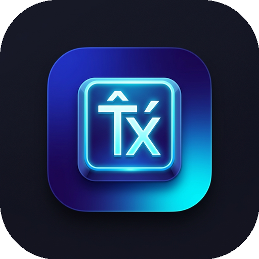

<p align="center">
  
</p>

<h1 align="center">TxTelex — Vietnamese Smart Keyboard</h1>

<p align="center">
  Bàn phím tiếng Việt cho Android · gõ Telex/VNI chuẩn · gõ vuốt · tự sửa chính tả · Theme Studio · chạy 100% trên máy
</p>

<p align="center">
  <a href="https://github.com/TXAVL/txtelex/releases"></a>
  
  
  
</p>


**Tải APK:** [Releases](https://github.com/TXAVL/txtelex/releases) · Package `nm.txa.telex` · Android 8.0 (API 26) trở lên

---

## Mục lục

- [Tính năng](#-tính-năng)
- [Cài lên điện thoại](#-cài-lên-điện-thoại)
- [Build nhanh trên Windows](#-build-nhanh-windows-1011-không-cần-android-studio)
- [Tool build](#️-tool-build-buildcmd)
- [Ký bản release & chuyển khoá sang máy khác](#-ký-bản-release)
- [Cài môi trường thủ công](#-cài-môi-trường-thủ-công)
- [Xử lý lỗi thường gặp](#️-xử-lý-lỗi-thường-gặp)
- [Cấu trúc mã nguồn](#-cấu-trúc-mã-nguồn)
- [Quyền riêng tư](#-quyền-riêng-tư)
- [Lịch sử phiên bản](#-lịch-sử-phiên-bản)
- [Bản quyền](#bản-quyền)

---

## ✨ Tính năng

**Gõ tiếng Việt**
- Telex, Telex đơn giản, VNI. Bỏ dấu kiểu mới hoặc cũ. Kiểm tra âm tiết hợp lệ.
- Tự trả về chữ tiếng Anh: `google`, `github`, `he is`, `camelCase`, email và URL không bị biến dấu.
- Sửa dấu cho từ vừa gõ xong. Gõ tắt (macro) với bảng mặc định có thể sửa.
- Ô mật khẩu và OTP tự tắt bỏ dấu. Thanh địa chỉ trình duyệt được xử lý riêng.

**Bàn phím**
- Gõ vuốt (VI và EN). Màn luyện gõ vuốt có sẵn trong app.
- Tự sửa lỗi chạm trượt dựa trên vị trí chạm. Tự cách sau dấu câu. Bong bóng phóng to khi bấm phím.
- Giữ phím Cách để làm trackpad di chuyển con trỏ 4 chiều. Vuốt trái phím ⌫ để xoá cả từ (có Undo). Vuốt ngang phím Cách để đổi VI ↔ EN.
- Giữ phím để ra nguyên âm có dấu hoặc ký hiệu phụ. Có đủ ký tự `< > { } [ ] ~ ^ …`.
- Chế độ một tay, bàn phím tách đôi, hàng phím số riêng, chỉnh chiều cao, cỡ chữ và độ trễ giữ phím.

**Thanh gợi ý**
- Gợi ý từ tiếp theo theo ngữ cảnh, ô gợi ý tốt nhất, 3–5 ô. Lọc từ nhạy cảm.
- Chip số, email và tên miền. **Máy tính** ngay trên thanh gợi ý: gõ `26,160*2,500=` là ra kết quả, 1 chạm để chèn.
- Dán nhanh khi vừa copy mã OTP hoặc link.

**Tuỳ biến — Theme Studio**
- Ảnh nền riêng, chỉnh làm mờ và độ tối. Chỉnh độ trong suốt của phím và chữ, bo góc, viền, màu chữ, màu nhấn.
- Âm phím cơ (Blue / Brown / Red switch, máy chữ, giọt nước) hoặc nạp file `.wav`/`.mp3` riêng, có chỉnh âm lượng.
- Chỉnh lực rung riêng cho phím thường, phím xoá và khi trượt con trỏ.
- Xem trước và gõ thử ngay trong app khi đang chỉnh.

**Công cụ**
- **Thêm dấu cả câu** cho văn bản không dấu, dựa trên mô hình ngôn ngữ chạy offline.
- Clipboard thông minh: lịch sử, ghim, ảnh, tự nhận diện OTP, URL và phép tính.
- Mẫu câu trả lời nhanh, từ điển cá nhân, bảng Emoji đầy đủ.
- Bảng Sửa văn bản (chọn, copy, dán, di chuyển con trỏ). Đổi kiểu chữ (HOA / thường / Viết Hoa Đầu Từ…).
- Sao lưu và khôi phục toàn bộ cài đặt. Dịch Việt ⇄ Anh (ML Kit, chỉ có trong bản Google Play).

**Ổn định**
- Hộp đen TXA ghi lại crash Java, crash native (`libtxaguard.so`), treo luồng chính và lý do app bị đóng (Android 11+).
- Màn báo lỗi có nút Sao chép / Chia sẻ, kèm thông tin thiết bị.

---

## 📱 Cài lên điện thoại

**Cách 1 — tải APK:** mở [Releases](https://github.com/TXAVL/txtelex/releases) trên điện thoại → tải `txtelex-<ver>-….apk` → mở để cài (cho phép *Cài ứng dụng không rõ nguồn gốc* nếu máy hỏi).

**Cách 2 — qua USB từ máy tính:**
1. Bật **Tuỳ chọn nhà phát triển** → **Gỡ lỗi USB**: https://developer.android.com/studio/debug/dev-options
2. Cắm cáp, chọn **Cho phép gỡ lỗi USB** trên điện thoại.
3. `.\build.cmd run`: build, cài và mở app.

Sau khi cài: mở TxTelex → **Bước 1** bật bàn phím trong Cài đặt → **Bước 2** chọn TxTelex làm bàn phím → gõ thử
`yeeu txa` → **yêu txa** ngay trong app.

> Các bản v0.1.0 → v0.5.0-alpha trên Releases chỉ có APK ký bằng **khoá debug**. Từ v0.6.0-alpha có thêm bản ký release (TXA STUDIO).
> Máy đang cài bản debug muốn chuyển sang bản release phải **gỡ TxTelex cũ trước** (Android không cho cài đè khi khoá ký khác nhau). Nhớ **Sao lưu** cài đặt trong app trước khi gỡ.

Máy không hiện trong `adb devices`: cài driver USB — Google/Pixel: https://developer.android.com/studio/run/win-usb ·
hãng khác (Samsung, Xiaomi, Oppo…): https://developer.android.com/studio/run/oem-usb

---

## ⚡ Build nhanh (Windows 10/11, không cần Android Studio)

```powershell
git clone https://github.com/TXAVL/txtelex.git
cd txtelex
.\setup.cmd          # cài JDK 17 + Android SDK + NDK + CMake (một lần, ~2–3 GB)
.\build.cmd          # menu chọn việc → vd [1] APK debug
```

`setup.cmd` tự phát hiện những gì máy đã có và chỉ cài phần còn thiếu, nên chạy lại bao nhiêu lần cũng được.

| Lệnh | Tác dụng |
|---|---|
| `.\setup.cmd -SdkRoot D:\Android` | Đặt Android SDK ở thư mục khác (mặc định `C:\Android`) |
| `.\setup.cmd -Build` | Cài xong thì build thử APK debug luôn |

> Lần build đầu tiên, Gradle tự tải Gradle 8.14.3 và thư viện (vài trăm MB). Cần Internet và mất vài phút.
> Các lần sau chỉ mất vài giây.

### Từ VPS / máy cũ sang máy thật

| Trên máy cũ (đang có khoá) | Trên máy thật |
|---|---|
| `.\build.cmd keystore-export` → đặt passphrase | `git clone …` → `cd txtelex` → `.\setup.cmd` |
| Chép file `dist\txtelex-keystore-<ngày>.txaks` sang máy thật | `.\build.cmd keystore-import -Path <file .txaks>` |
| | `.\build.cmd doctor` → toàn ✔ → `.\build.cmd release` |

Chi tiết ở mục [Ký bản release](#-ký-bản-release).

---

## 🛠️ Tool build (`build.cmd`)

Chạy `.\build.cmd` không kèm tham số sẽ hiện **menu chọn số**. Cũng có thể gõ thẳng tên lệnh:

| Lệnh | Kết quả trong `dist\` |
|---|---|
| `.\build.cmd debug` | `txtelex-<ver>-debug.apk` (ký debug, để cài thử) |
| `.\build.cmd release` | `txtelex-<ver>-release.apk` (ký khoá release, thu gọn bằng R8) |
| `.\build.cmd aab` | `txtelex-<ver>.aab`, file nộp Google Play (có module Dịch) |
| `.\build.cmd all` | Chạy test và tạo cả 3 file trên |
| `.\build.cmd test` | Chạy toàn bộ unit test (~370 test) |
| `.\build.cmd run` | Build debug, cài lên điện thoại đang cắm USB và mở app |
| `.\build.cmd install release` | Build bản release và cài lên điện thoại |
| `.\build.cmd clean` | Dọn `build\` và `dist\` |
| `.\build.cmd doctor` | Kiểm tra JDK, SDK, NDK, CMake, keystore, điện thoại và dung lượng ổ đĩa |
| `.\build.cmd keystore-export` | Gói keystore và mật khẩu thành `txtelex-keystore-<ngày>.txaks` (đã mã hoá) |
| `.\build.cmd keystore-import -Path <file>` | Cài keystore từ file `.txaks` vào máy này |
| `.\build.cmd key-password` | Xem mật khẩu keystore đã cất trong Windows Credential Manager |
| `.\build.cmd help` | Hướng dẫn đầy đủ |

**Tool hiển thị:**
- Dòng trạng thái động trong lúc build: thời gian chạy, số bước đã xong và task Gradle đang chạy.
- Bảng kết quả sau mỗi lệnh. Mỗi file có tên, cỡ, SHA-256 và tên bên ký (`✔ TXA STUDIO` / `✔ debug key` / `▲ chưa ký`).
- Khung đỏ khi lỗi, nêu **nguyên nhân và cách sửa**, ví dụ:

```
  ╭─ BUILD LỖI (mã 1) ─────────────────────────────────────────────╮
  │ Nguyên nhân: Lỗi biên dịch Kotlin (2 chỗ).                     │
  │ → Sửa các dòng bên dưới rồi build lại.                         │
  │   ▸ ime\TypingSession.kt:212:18                                │
  │       Unresolved reference 'commitWord'.                       │
  │ Log đầy đủ: build\txa-logs\20261019-095621-APK_debug.log       │
  ╰────────────────────────────────────────────────────────────────╯
```

Các lỗi tool tự nhận ra:

| Loại lỗi | Tool báo gì |
|---|---|
| Lỗi biên dịch Kotlin | `file:dòng:cột` kèm thông báo lỗi |
| Unit test hỏng | Tên test, thông báo assert và dòng gây lỗi |
| Keystore | Sai mật khẩu hoặc không thấy file `.jks` |
| Môi trường | Thiếu SDK, NDK hoặc CMake, sai bản Java |
| Hệ thống | Lỗi mạng hoặc proxy, Gradle hết bộ nhớ, Gradle đang bị khoá |
| Cài lên máy | Không thấy điện thoại, máy chưa cho phép gỡ lỗi USB, khoá ký khác, hết dung lượng, máy chặn cài qua USB |

Log Gradle đầy đủ của mỗi lần chạy nằm ở `build\txa-logs\`.

Gọi Gradle trực tiếp cũng được (sau khi đã chạy `setup.cmd`):
```powershell
.\gradlew.bat testDebugUnitTest
.\gradlew.bat assembleDebug        # app\build\outputs\apk\debug\app-debug.apk
.\gradlew.bat bundleRelease        # app\build\outputs\bundle\release\app-release.aab
```

---

## 🔐 Ký bản release

Bản **debug** không cần làm gì thêm. Bản **release / AAB** cần keystore, và file này cố ý **không có trong repo**
(`.gitignore` chặn `*.jks`, `*.keystore`, `*.txaks`, `keystore.properties`).

### Chuyển khoá sang máy khác

Phải dùng lại **đúng khoá cũ**: đổi khoá thì không cập nhật được app trên Google Play nữa.

1. **Trên máy đang có khoá:** chạy `.\build.cmd keystore-export` rồi đặt một passphrase (ít nhất 10 ký tự).
   Tool tạo file `dist\txtelex-keystore-<ngày>.txaks`. File này chứa file `.jks`, alias và mật khẩu,
   được mã hoá AES-256-CBC + HMAC-SHA256, với khoá dẫn xuất bằng PBKDF2-SHA256 300 000 vòng.
2. **Mang file sang máy mới** bằng một trong các cách sau:
   - Remote Desktop: copy file trong Explorer của VPS rồi paste ra máy mình.
   - Google Drive / OneDrive / Telegram (Saved Messages): tải lên rồi tải về.
   - USB hoặc ổ cứng ngoài.

   **Gửi passphrase qua kênh khác** với file.
3. **Trên máy mới**, trong thư mục repo: `.\build.cmd keystore-import -Path D:\txtelex-keystore-<ngày>.txaks`.
   Lệnh này giải mã file, đặt `.jks` vào `%USERPROFILE%\keystores\`, kiểm tra khoá bằng `keytool`, tạo `keystore.properties`
   và cất mật khẩu vào Windows Credential Manager. Không ghi tên file thì tool tự tìm file `.txaks` trong `dist\`, Downloads và Desktop.
4. Chạy `.\build.cmd release`. Cột *Ký bởi* hiện `✔ TXA STUDIO` nghĩa là đúng khoá.

Cũng có thể làm tay: chép file `.jks`, chép `keystore.properties.example` thành `keystore.properties`, rồi điền đường dẫn và mật khẩu.

### Chưa có khoá

Chỉ làm **một lần** cho cả đời app:
```powershell
keytool -genkeypair -v -keystore $HOME\keystores\txtelex-release.jks -storetype PKCS12 `
  -alias txtelex -keyalg RSA -keysize 4096 -validity 10950 `
  -dname "CN=TxTelex 2027, OU=TxTelex Keyboard, O=TXA STUDIO, L=Ho Chi Minh City, C=VN"
```
`keytool` nằm trong `%JAVA_HOME%\bin`. Cất mật khẩu vào Windows Credential Manager để `build.cmd key-password` đọc lại được:
```powershell
cmdkey /generic:TxTelex/release-keystore /user:txtelex /pass:<mật khẩu>
```

> ⚠️ **Mất file `.jks` hoặc mật khẩu thì sẽ không bao giờ cập nhật được app trên Google Play.** Hãy giữ ít nhất
> một bản sao ở nơi khác ngoài máy build, ví dụ file `.txaks` cất trong Google Drive kèm passphrase lưu trong Bitwarden / 1Password.
> Khi tạo app trên Play Console, nên bật **Play App Signing** để còn đường khôi phục.

---

## 🧰 Cài môi trường thủ công

Phần này dành cho trường hợp không muốn dùng `setup.cmd`.

| Công cụ | Phiên bản | Tải chính thức |
|---|---|---|
| Git | mới nhất | https://git-scm.com/downloads/win · hoặc `winget install -e --id Git.Git` |
| JDK | **17** | Microsoft: https://learn.microsoft.com/java/openjdk/download#openjdk-17 · hoặc Temurin: https://adoptium.net/temurin/releases/?version=17 · hoặc `winget install -e --id Microsoft.OpenJDK.17` |
| Android command-line tools | 11076708 | https://developer.android.com/studio#command-line-tools-only (file `commandlinetools-win-…_latest.zip`) |
| platform-tools (adb) | mới nhất | qua `sdkmanager` (bên dưới) |
| Android SDK Platform | **35** | qua `sdkmanager` |
| Build-Tools | **35.0.0** | qua `sdkmanager` |
| NDK | **27.2.12479018** | qua `sdkmanager` (cho bộ bắt crash native `libtxaguard.so`) |
| CMake | **3.22.1** | qua `sdkmanager` |
| winget (nếu máy chưa có) | — | cài "App Installer": https://learn.microsoft.com/windows/package-manager/winget/ |

```powershell
# 1. JDK 17
winget install -e --id Microsoft.OpenJDK.17

# 2. Android command-line tools → C:\Android\cmdline-tools\latest
New-Item -ItemType Directory -Force -Path C:\Android\cmdline-tools | Out-Null
Invoke-WebRequest https://dl.google.com/android/repository/commandlinetools-win-11076708_latest.zip -OutFile $env:TEMP\clt.zip
Expand-Archive $env:TEMP\clt.zip -DestinationPath $env:TEMP\clt -Force
Move-Item $env:TEMP\clt\cmdline-tools C:\Android\cmdline-tools\latest

# 3. Biến môi trường (mở lại PowerShell sau khi chạy)
[Environment]::SetEnvironmentVariable("ANDROID_HOME", "C:\Android", "User")

# 4. Giấy phép + gói SDK
C:\Android\cmdline-tools\latest\bin\sdkmanager.bat --licenses
C:\Android\cmdline-tools\latest\bin\sdkmanager.bat "platform-tools" "platforms;android-35" "build-tools;35.0.0" "ndk;27.2.12479018" "cmake;3.22.1"

# 5. Trỏ project vào SDK (trong thư mục repo)
Set-Content local.properties 'sdk.dir=C\:\\Android'
```

---

## 🩺 Xử lý lỗi thường gặp

Chưa rõ máy thiếu gì thì chạy `.\build.cmd doctor` trước.

| Lỗi | Cách sửa |
|---|---|
| `SDK location not found` | Chạy `.\setup.cmd` (tạo `local.properties`) |
| `JAVA_HOME is not set` / sai bản Java | Chạy `.\setup.cmd`, hoặc cài JDK **17** (không phải 8, 11 hay 21) rồi mở lại PowerShell |
| `NDK not configured` / `CMake '3.22.1' was not found` | Chạy `sdkmanager "ndk;27.2.12479018" "cmake;3.22.1"` hoặc chạy lại `setup.cmd` |
| `Could not find or load main class Files\…` khi chạy test | PATH của Windows có mục chứa dấu `"`. `build.cmd` tự lọc mục đó; nếu gọi `gradlew` trực tiếp thì sửa PATH trong *System Properties › Environment Variables* |
| `running scripts is disabled on this system` | Dùng `build.cmd` / `setup.cmd` (đã kèm `-ExecutionPolicy Bypass`) thay vì gọi file `.ps1` trực tiếp |
| `INSTALL_FAILED_UPDATE_INCOMPATIBLE` khi cài | Máy đang có bản ký bằng khoá khác (debug ↔ release). Gỡ TxTelex cũ rồi cài lại |
| Xiaomi / Oppo chặn cài qua USB | Bật *Cài qua USB* trong Tuỳ chọn nhà phát triển |
| Bản release báo *APK chưa được ký* | Thiếu hoặc sai `keystore.properties`. Xem mục [Ký bản release](#-ký-bản-release) |
| `keystore-import` báo *Sai passphrase* | Gõ lại đúng passphrase đã đặt lúc export. Vẫn lỗi thì file chép chưa trọn, hãy chép lại |
| Dịch Việt ⇄ Anh không chạy trong bản APK | Bình thường: module Dịch chỉ có trong bản AAB / Google Play |
| Tải chậm / lỗi mạng khi build lần đầu | Gradle cần truy cập `dl.google.com`, `repo.maven.apache.org` và `services.gradle.org`. Kiểm tra proxy / tường lửa |

---

## 🗂️ Cấu trúc mã nguồn

```
.
├── setup.cmd / setup.ps1         # cài JDK + Android SDK + NDK + CMake
├── build.cmd / build.ps1         # tool build (menu, doctor, keystore-export/import)
├── scripts/txa-ui.ps1            # giao diện console + chẩn đoán lỗi dùng chung
├── keystore.properties.example   # mẫu cấu hình ký release
├── app/
│   └── src/main/java/com/customkey/vietime/
│       ├── engine/         # lõi tiếng Việt thuần Kotlin: Telex/VNI, chính tả, khôi phục tiếng Anh,
│       │                   #   gợi ý, mô hình ngôn ngữ, gõ vuốt, gõ tắt, thêm dấu, tự sửa chạm trượt
│       ├── ime/            # InputMethodService, InputBridge, phân loại ô nhập, cử chỉ, phiên gõ
│       ├── customization/  # theme, âm phím (SoundPool), rung, bố cục
│       ├── tools/          # clipboard, mẫu câu, thêm dấu cả câu, máy tính, đổi kiểu chữ, sao lưu, Plus, dịch
│       ├── diag/           # hộp đen TXA: logger, bắt crash Java/native/ANR, màn báo lỗi
│       └── ui/             # onboarding + gõ thử, bàn phím (Canvas), màn cài đặt (Compose)
│   └── src/main/cpp/       # txa_guard.c — bắt tín hiệu crash native
├── translate/              # module on-demand Dịch (ML Kit, chỉ trong AAB)
└── docs/assets/            # icon, ảnh Play Store
```

| Thành phần | Phiên bản |
|---|---|
| Kotlin | 2.0.21 |
| Android Gradle Plugin | 8.13.0 |
| Gradle | 8.14.3 |
| JDK | 17 |
| compileSdk / targetSdk / minSdk | 35 / 35 / 26 |
| NDK / CMake | 27.2.12479018 / 3.22.1 |

Package `engine/` không được import `android.*` hay `androidx.*`. Test `RequiredRegressionTest` kiểm tra điều này.

---

## 🔒 Quyền riêng tư

- Mọi xử lý gõ, gợi ý, gõ vuốt và thêm dấu đều **chạy trên máy**. Không có máy chủ, không thu thập chữ đã gõ.
- Lịch sử clipboard, mẫu câu và từ điển cá nhân chỉ nằm trong bộ nhớ của app.
- Nhật ký chẩn đoán (`TxaLogger`) **không bao giờ ghi chữ người dùng gõ hay nội dung clipboard**. Thông tin thiết bị
  chỉ được ghép vào khi chính bạn bấm Sao chép / Chia sẻ trên màn báo lỗi.
- Ô mật khẩu và OTP: không bỏ dấu, không gợi ý, không lưu.

---

## 📜 Lịch sử phiên bản

| Phiên bản | Nội dung chính |
|---|---|
| **v0.7.0-alpha** | Giao diện app làm lại: 4 tab (Kiểu gõ · Giao diện · Công cụ · Giới thiệu), thanh tab nổi, sáng/tối theo hệ thống; bàn phím mặc định theo hệ thống |
| v0.6.0-alpha | Tự sửa chạm trượt, đủ ký tự `< >`, giữ phím ra chữ có dấu, bong bóng phím, chế độ một tay, vuốt tiếng Anh, thanh gợi ý mới (ô tốt nhất, hàng công cụ, chip số/email), bảng Sửa văn bản, đổi kiểu chữ, Gõ tắt, Sao lưu & khôi phục |
| v0.5.0-alpha | Clipboard hình ảnh, dán nhanh từ thanh gợi ý, từ điển cá nhân, bảng Emoji đầy đủ |
| v0.4.0-alpha | Hộp đen TXA: TxaLogger, TxaErrorScreen, bắt crash Java / native / treo |
| v0.3.1-alpha | Sửa crash khi khởi động (ML Kit provider) |
| v0.3.0-alpha | Thêm dấu cả câu, máy tính trên thanh gợi ý, clipboard thông minh, mẫu câu, Plus, Dịch |
| v0.2.0-alpha | Theme Studio, âm phím cơ, rung, bố cục |
| v0.1.0-alpha | Engine Telex/VNI, IME, onboarding, gõ thử, luyện gõ vuốt |

Ngoài app, tool build mới có thêm: `setup.cmd`, menu, `doctor`, chẩn đoán lỗi, `keystore-export` / `keystore-import`.

---

## Bản quyền

© 2026 TXA. Tên, logo, giao diện và hệ thống tuỳ biến TxTelex thuộc về TXA.

### Thành phần bên thứ ba

Bộ xử lý Telex/VNI trong `app/src/main/java/com/customkey/vietime/engine/` dựa trên
[viettelex](https://github.com/ptrinh/viettelex), giấy phép MIT (Copyright (c) 2026 Phil Trinh).
Toàn văn giấy phép nằm ở `app/src/main/assets/licenses/viettelex-LICENSE.txt` và trong app ở *Giới thiệu › Thành phần mã nguồn mở*.
